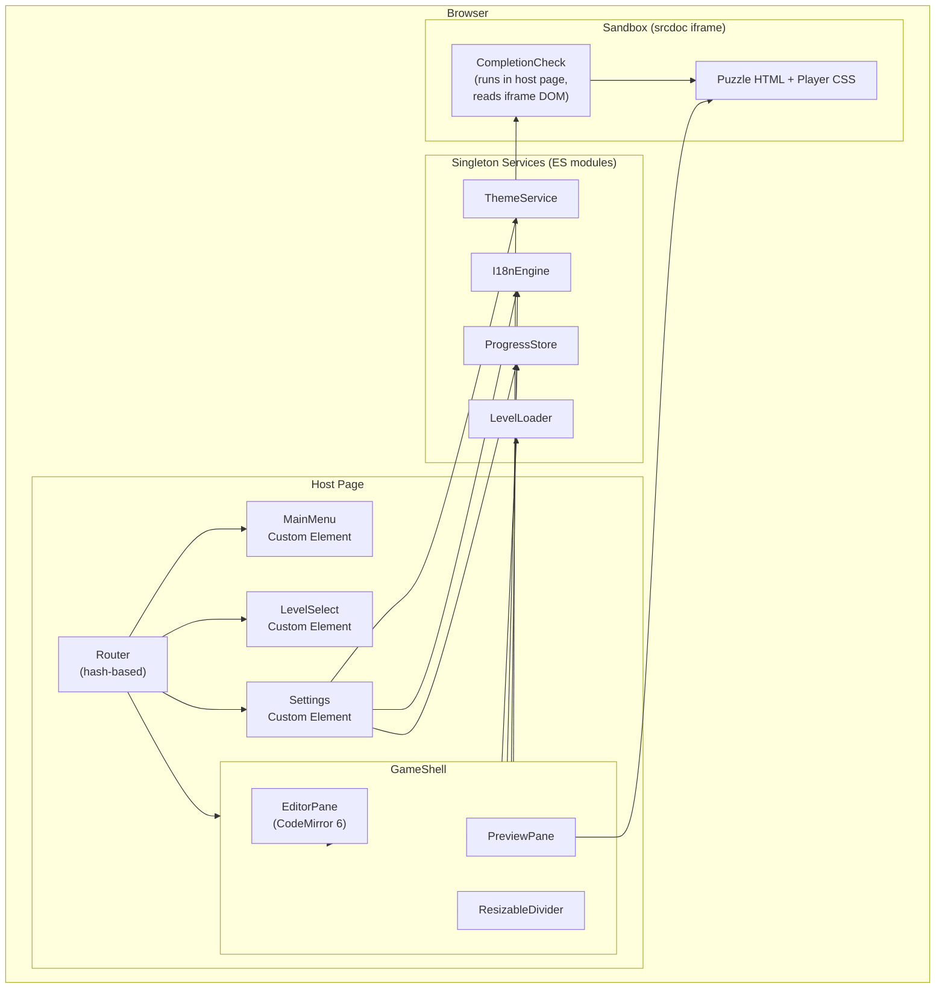
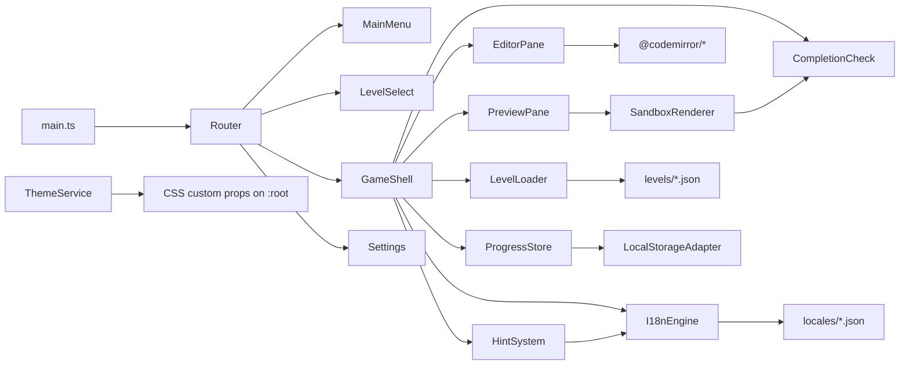

# Design Document

## Overview

The CSS Learning Game is a client-side-only web application. No server is required after the initial asset load. All game state lives in the browser's `localStorage`. The build output is a directory of static files that can be served from any CDN or file server and that runs fully offline via a Service Worker.

The design uses **TypeScript** compiled to ES modules, with **Vite** as the build tool. The runtime has no heavy framework dependency. The UI is structured as a small set of hand-written custom elements (`HTMLElement` subclasses) that own their own shadow DOM, giving clean style encapsulation without React/Vue overhead. [CodeMirror 6](https://codemirror.net/) (`@codemirror/view`, `@codemirror/lang-css`) provides the editor; it ships as ES modules and tree-shakes well, keeping the editor bundle under ~120 KB gzipped. [fast-check](https://fast-check.dev/) is the property-based testing library.

**Key design decisions:**

| Decision | Choice | Rationale |
|---|---|---|
| Framework | No runtime framework | Keeps initial bundle small; custom elements are natively supported |
| Editor | CodeMirror 6 | Modular, tree-shakeable, built-in CSS language support and autocomplete |
| PBT library | fast-check | MIT, works with Vitest, rich arbitraries, automatic shrinking |
| Test runner | Vitest | Native ESM, fast, compatible with Vite build |
| Styling | CSS custom properties + data-theme attribute | Zero-JS theme switching |
| I18n | Flat JSON key→value files, runtime loader | No build-time dependency, easy to add locales |
| Persistence | `localStorage` JSON | No backend, works offline |
| Sandbox | `srcdoc` iframe + `sandbox="allow-same-origin"` | Same-origin allows `getComputedStyle` reads; `allow-same-origin` without `allow-scripts` blocks player JS |

---

## Architecture

### High-Level Component Diagram



### Module Dependency Graph



### Directory Structure

```
src/
  components/
    main-menu/
      MainMenu.ts
      main-menu.css
    level-select/
      LevelSelect.ts
      level-select.css
    game-shell/
      GameShell.ts
      game-shell.css
      EditorPane.ts
      PreviewPane.ts
      HintSystem.ts
      ResizableDivider.ts
    settings/
      Settings.ts
      settings.css
  services/
    CompletionCheck.ts
    I18nEngine.ts
    LevelLoader.ts
    ProgressStore.ts
    SandboxRenderer.ts
    ThemeService.ts
  types/
    level.ts
    progress.ts
    i18n.ts
  sw.ts                  (Service Worker)
  main.ts
data/
  levels/
    01-flexbox/
      01-01.json
      ...
  locales/
    en.json
    es.json
public/
  themes/
    ocean.css
    forest.css
    space.css
```

---

## Components and Interfaces

### Router

A lightweight hash-based router. No external library.

```typescript
// src/Router.ts

type Route = { pattern: RegExp; render: (params: Record<string, string>) => HTMLElement };

class Router {
  private routes: Route[] = [];

  register(pattern: RegExp, render: (params: Record<string, string>) => HTMLElement): void;
  navigate(path: string): void;
  private handleHashChange(): void;
}
```

Routes:
- `#/` → `MainMenu`
- `#/levels` → `LevelSelect`
- `#/play/:chapterId/:levelId` → `GameShell`
- `#/settings` → `Settings`

### GameShell

The main gameplay view. Owns the editor, preview, hint UI, and score display.

```typescript
// src/components/game-shell/GameShell.ts

class GameShell extends HTMLElement {
  private level: Level;
  private editor: EditorPane;
  private preview: PreviewPane;
  private hintSystem: HintSystem;
  private divider: ResizableDivider;
  private hintsUsed = 0;
  private attempts = 0;

  connectedCallback(): void;
  private loadLevel(levelId: string): Promise<void>;
  private onEditorChange(css: string): void;        // debounced 300 ms
  private onPreviewSolved(): void;
  private computeScore(): 1 | 2 | 3;
  private resetLevel(): void;
  private showCompletionDialog(score: 1 | 2 | 3): void;
}
```

### EditorPane

Wraps a CodeMirror 6 `EditorView`. Emits a `css-change` custom event on each keystroke (the host debounces it).

```typescript
// src/components/game-shell/EditorPane.ts
import { EditorView, basicSetup } from "codemirror";
import { css } from "@codemirror/lang-css";

class EditorPane extends HTMLElement {
  private view: EditorView;

  connectedCallback(): void;        // mounts CodeMirror into shadow root
  setScaffold(html: string): void;  // sets read-only scaffold block
  getCSS(): string;                 // returns player-writable lines
  reset(): void;                    // restores initial scaffold state
  markError(line: number, message: string): void;
  clearErrors(): void;
}
```

CodeMirror configuration:

```typescript
const extensions = [
  basicSetup,                // line numbers, undo, key bindings
  css(),                     // CSS language + built-in autocomplete
  EditorView.updateListener.of(update => {
    if (update.docChanged) {
      this.dispatchEvent(new CustomEvent("css-change", { detail: update.state.doc.toString() }));
    }
  }),
  keymap.of([indentWithTab]),  // Tab → 2 spaces
];
```

The `css()` language package from `@codemirror/lang-css` provides CSS property autocomplete (top-5 values) and syntax highlighting out of the box, satisfying Requirements 4.2, 4.3.

### PreviewPane

Hosts the sandbox `<iframe>`. Updates it via `srcdoc` assignment. Calls `CompletionCheck` after each render settles.

```typescript
// src/components/game-shell/PreviewPane.ts

class PreviewPane extends HTMLElement {
  private iframe: HTMLIFrameElement;
  private currentLevel: Level | null = null;

  connectedCallback(): void;
  setLevel(level: Level): void;
  update(playerCSS: string): void;    // rewrites iframe srcdoc, then checks
  private buildSrcdoc(level: Level, playerCSS: string): string;
  private scheduleCheck(): void;      // rAF-based, runs after layout
}
```

`buildSrcdoc` produces:

```html
<!DOCTYPE html>
<html>
<head>
  <style>/* game reset + scene base styles */</style>
  <style id="player">/* player CSS injected here */</style>
</head>
<body>
  <!-- level.scaffoldHTML injected verbatim -->
</body>
</html>
```

The iframe attribute is `sandbox="allow-same-origin"` — no `allow-scripts`, so the player cannot run JavaScript inside the sandbox. `allow-same-origin` lets the host page call `iframe.contentDocument.defaultView.getComputedStyle(el)`.

### CompletionCheck

A pure function module with no side effects. All DOM reads come in as arguments (testable without a real iframe).

```typescript
// src/services/CompletionCheck.ts

export interface ElementTarget {
  selector: string;
  expectedCenterX: number;   // px, relative to sandbox viewport
  expectedCenterY: number;
  expectedWidth: number;
  expectedHeight: number;
  tolerance: number;         // defaults to 4
}

export type CheckResult = "solved" | "not-solved";

/**
 * Reads computed layout from the sandbox document and compares to target.
 * Pure function: DOM reading is injected via the `measure` callback.
 */
export function checkCompletion(
  targets: ElementTarget[],
  measure: (selector: string) => DOMRect | null
): CheckResult;

/**
 * Live version: reads from the actual iframe contentDocument.
 */
export function checkCompletionLive(
  targets: ElementTarget[],
  sandboxDocument: Document
): CheckResult;
```

Algorithm:

```
function checkCompletion(targets, measure):
  for each target in targets:
    rect = measure(target.selector)
    if rect is null: return "not-solved"
    centerX = rect.left + rect.width / 2
    centerY = rect.top  + rect.height / 2
    if |centerX - target.expectedCenterX| > target.tolerance: return "not-solved"
    if |centerY - target.expectedCenterY| > target.tolerance: return "not-solved"
    if |rect.width  - target.expectedWidth|  > target.tolerance: return "not-solved"
    if |rect.height - target.expectedHeight| > target.tolerance: return "not-solved"
  return "solved"
```

### HintSystem

```typescript
// src/components/game-shell/HintSystem.ts

class HintSystem {
  private hintsUsed = 0;
  private readonly maxHints = 3;
  private level: Level;
  private editor: EditorPane;

  constructor(level: Level, editor: EditorPane);
  requestHint(): HintResult;
  reset(): void;
  get remaining(): number;
}

type HintResult =
  | { type: "property-name"; text: string }
  | { type: "full-declaration"; text: string }
  | { type: "full-solution"; css: string }
  | { type: "exhausted" };
```

### ResizableDivider

Handles pointer events to let the player drag the split ratio between 25% and 75%.

```typescript
class ResizableDivider extends HTMLElement {
  private ratio = 0.5;  // restored from sessionStorage

  connectedCallback(): void;
  private onPointerDown(e: PointerEvent): void;
  private onPointerMove(e: PointerEvent): void;
  private onPointerUp(e: PointerEvent): void;
  private clampRatio(r: number): number;  // clamps to [0.25, 0.75]
  private applyRatio(): void;
}
```

### ProgressStore

```typescript
// src/services/ProgressStore.ts

export interface LevelRecord {
  status: "locked" | "unlocked" | "completed";
  bestScore: 1 | 2 | 3 | null;
}

export interface ProgressData {
  version: 1;
  levels: Record<string, LevelRecord>;   // key: "chapterId/levelId"
  selectedLocale: string;
  selectedTheme: string;
}

class ProgressStore {
  private static readonly KEY = "css-game-progress-v1";

  load(): ProgressData;
  save(data: ProgressData): void;
  update(levelKey: string, record: Partial<LevelRecord>): void;
  reset(): void;
  isAvailable(): boolean;
}
```

`save()` serializes to JSON and calls `localStorage.setItem`. On `QuotaExceededError` it emits a `storage-full` custom event that `Settings` listens to in order to display the warning.

### I18nEngine

```typescript
// src/services/I18nEngine.ts

type TranslationMap = Record<string, string>;

class I18nEngine {
  private locale: string = "en";
  private translations: TranslationMap = {};
  private static readonly SUPPORTED = ["en", "es"];

  async setLocale(locale: string): Promise<void>;   // loads JSON, fires "locale-changed" event
  t(key: string, vars?: Record<string, string>): string;
  detectBrowserLocale(): string;
  getSupportedLocales(): string[];
}
```

`t(key, vars)` algorithm:

```
function t(key, vars):
  raw = this.translations[key] ?? this.translations["en"][key] ?? key
  if vars is not empty:
    for each [name, value] in vars:
      raw = raw.replace("{{name}}", value)   // global replace
  assert raw contains no remaining "{{...}}" placeholders
  return raw
```

`setLocale` fetches `/locales/{locale}.json`, merges into `this.translations`, then saves the choice to `ProgressStore`, then fires a `locale-changed` custom event that all rendered text nodes listen to for re-render.

### ThemeService

```typescript
// src/services/ThemeService.ts

type ThemeName = "ocean" | "forest" | "space";

class ThemeService {
  apply(theme: ThemeName): void;   // sets data-theme on <html>
  load(): void;                    // reads from ProgressStore on startup
}
```

Themes are defined as CSS custom-property blocks in `public/themes/{name}.css`, loaded at build time and gated by `[data-theme="ocean"] { --color-bg: ...; }`. Switching theme takes ~1 frame (no JS computation), meeting the 150 ms requirement.

---

## Data Models

### Level JSON Schema

```typescript
// src/types/level.ts

export interface Level {
  id: string;             // e.g. "01-01"
  chapterId: string;      // e.g. "flexbox"
  titleKey: string;       // I18n key for level title
  instructionKey: string; // I18n key for instruction text
  scaffoldHTML: string;   // read-only HTML shown to player
  initialCSS: string;     // pre-filled editable CSS (may be empty)
  solution: string;       // one valid solution (not shown to player)
  targets: ElementTarget[]; // layout correctness targets
  hints: [string, string, string]; // [propertyNameKey, fullDeclKey, fullSolutionCSS]
  tags: string[];         // e.g. ["flexbox", "justify-content"]
}
```

Example `data/levels/01-flexbox/01-01.json`:

```json
{
  "id": "01-01",
  "chapterId": "flexbox",
  "titleKey": "level.flexbox.01-01.title",
  "instructionKey": "level.flexbox.01-01.instruction",
  "scaffoldHTML": "<div class=\"container\"><div class=\"frog\"></div></div>",
  "initialCSS": ".container {\n  display: flex;\n  /* add justify-content here */\n}",
  "solution": ".container { display: flex; justify-content: center; }",
  "targets": [
    {
      "selector": ".frog",
      "expectedCenterX": 160,
      "expectedCenterY": 80,
      "expectedWidth": 40,
      "expectedHeight": 40,
      "tolerance": 4
    }
  ],
  "hints": [
    "hint.property.justify-content",
    "hint.declaration.justify-content-center",
    ".container { display: flex; justify-content: center; }"
  ],
  "tags": ["flexbox", "justify-content"]
}
```

### Chapter Manifest

```typescript
// src/types/level.ts

export interface Chapter {
  id: string;
  nameKey: string;
  levelIds: string[];   // ordered
}
```

`data/chapters.json` lists all chapters in order. The `LevelLoader` fetches individual level JSON files lazily (dynamic import or `fetch`), satisfying the lazy-loading performance requirement.

### Progress Store Schema (localStorage)

```json
{
  "version": 1,
  "levels": {
    "flexbox/01-01": { "status": "completed", "bestScore": 3 },
    "flexbox/01-02": { "status": "unlocked",  "bestScore": null },
    "flexbox/01-03": { "status": "locked",    "bestScore": null }
  },
  "selectedLocale": "es",
  "selectedTheme": "ocean"
}
```

### Locale File Schema

`locales/en.json`:

```json
{
  "menu.play": "Play",
  "menu.settings": "Settings",
  "level.flexbox.01-01.title": "Center a Frog",
  "level.flexbox.01-01.instruction": "Use justify-content to center the frog.",
  "hint.property.justify-content": "You need the justify-content property, which controls horizontal alignment of flex children.",
  "hint.declaration.justify-content-center": "Try: justify-content: center;",
  "settings.language": "Language",
  "settings.theme": "Theme",
  "settings.reset": "Reset Progress",
  "error.storage-full": "Your browser storage is full. Progress will not be saved this session."
}
```

CSS property names and values are never stored as keys; they appear only in scaffold HTML and solution strings which the I18n engine never touches (Requirement 9.4).

---

## Correctness Properties

*A property is a characteristic or behavior that should hold true across all valid executions of a system — essentially, a formal statement about what the system should do. Properties serve as the bridge between human-readable specifications and machine-verifiable correctness guarantees.*

### Property 1: CompletionCheck is deterministic (idempotent)

*For any* fixed set of `ElementTarget` values and any fixed `measure` function, calling `checkCompletion` any number of times with the same arguments SHALL always return the same result.

**Validates: Requirements 15.4**

### Property 2: CompletionCheck accepts any equivalent layout

*For any* `ElementTarget[]` for a level, and any CSS string whose computed layout positions every target within tolerance, `checkCompletion` SHALL return `"solved"`.

**Validates: Requirements 15.2, 15.7**

### Property 3: CompletionCheck rejects out-of-tolerance layouts

*For any* `ElementTarget[]` for a level, and any `measure` function that returns a `DOMRect` where at least one target's center or size deviates from the expected value by more than `tolerance`, `checkCompletion` SHALL return `"not-solved"`.

**Validates: Requirements 15.3**

### Property 4: CompletionCheck returns "not-solved" on empty scaffold

*For any* level, when `measure` returns the layout produced by the initial scaffold CSS (no player input), `checkCompletion` SHALL return `"not-solved"`.

**Validates: Requirements 15.5**

### Property 5: I18n never returns empty string

*For any* supported locale and any registered string key, `I18nEngine.t(key)` SHALL return a non-empty string.

**Validates: Requirements 16.1**

### Property 6: I18n key completeness across locales

*For any* key present in the `en` locale translation map, the same key SHALL exist in every other supported locale's translation map.

**Validates: Requirements 16.2**

### Property 7: I18n applying same locale is idempotent

*For any* supported locale L, applying `setLocale(L)` twice in sequence and then calling `t(key)` SHALL return the same string as calling `t(key)` after a single `setLocale(L)`.

**Validates: Requirements 16.3**

### Property 8: I18n does not mutate interpolation-free strings

*For any* string key whose stored value contains no `{{...}}` placeholders, `t(key)` SHALL return the stored string character-for-character.

**Validates: Requirements 16.4**

### Property 9: I18n substitutes all placeholders

*For any* string key whose stored value contains exactly N named placeholders, calling `t(key, vars)` with N matching variable names SHALL return a string containing zero remaining `{{...}}` substrings.

**Validates: Requirements 16.5**

### Property 10: Score is non-decreasing on replay

*For any* completed level record with a stored `bestScore` of S, and any replay that produces score R, the value written back to `ProgressStore` SHALL be `max(S, R)`.

**Validates: Requirements 6.3, 6.4**

---

## Error Handling

| Error Condition | Handling |
|---|---|
| `localStorage` unavailable or full | `ProgressStore.isAvailable()` returns false; `GameShell` shows a dismissible banner; game continues without persistence |
| Locale JSON fetch fails | `I18nEngine.setLocale` falls back to `en`; a console warning is logged |
| Level JSON fetch fails | `LevelLoader` shows an error state in `GameShell` with a retry button |
| Player CSS parse error | CodeMirror's CSS parser underlines the token; `PreviewPane` retains last valid render |
| Player CSS `@import` external URL | `SandboxRenderer` strips `@import` rules before inserting into srcdoc; `EditorPane.markError` is called |
| Player CSS `url()` external resource | Same stripping approach; inline `data:` URIs are allowed, http/https are blocked |
| `iframe` contentDocument unavailable | `CompletionCheck` returns `"not-solved"` gracefully; no exception propagates |
| Service Worker registration fails | The game loads normally without offline support; no user-visible error |

CSS stripping is performed by a small regex-based pre-processor before the CSS reaches the iframe:

```typescript
// src/services/SandboxRenderer.ts

function sanitizeCSS(raw: string): { css: string; warnings: SanitizeWarning[] } {
  const warnings: SanitizeWarning[] = [];
  let css = raw.replace(/@import\s+url\([^)]+\)/gi, (match) => {
    warnings.push({ type: "blocked-import", source: match });
    return "/* blocked */";
  });
  css = css.replace(/url\(\s*['"]?https?:\/\/[^)]+['"]?\s*\)/gi, (match) => {
    warnings.push({ type: "blocked-url", source: match });
    return "url(about:blank)";
  });
  return { css, warnings };
}
```

---

## Testing Strategy

### Unit and Integration Tests (Vitest)

Unit tests target pure logic: `CompletionCheck`, `I18nEngine`, `ProgressStore`, `SandboxRenderer.sanitizeCSS`, `HintSystem`, and score calculation. Integration tests cover the `Router`, level unlock logic, and the `localStorage` save/restore cycle using Vitest's `jsdom` environment.

Avoid testing CodeMirror internals or iframe rendering in unit tests — those are covered by end-to-end tests.

### Property-Based Tests (fast-check + Vitest)

The property-based testing library is [fast-check](https://fast-check.dev/). Each test runs a minimum of 100 iterations (configured via `{ numRuns: 100 }`). Each test is tagged with a comment referencing the design property it validates.

**Tag format:** `// Feature: css-learning-game, Property N: <property text>`

#### Property 1: CompletionCheck determinism

```typescript
// Feature: css-learning-game, Property 1: CompletionCheck is deterministic (idempotent)
fc.assert(
  fc.property(
    fc.array(arbElementTarget(), { minLength: 1, maxLength: 6 }),
    fc.func(fc.oneof(fc.constant(null), arbDOMRect())),
    (targets, measure) => {
      const r1 = checkCompletion(targets, measure);
      const r2 = checkCompletion(targets, measure);
      return r1 === r2;
    }
  ),
  { numRuns: 100 }
);
```

#### Property 2: CompletionCheck accepts any in-tolerance layout

```typescript
// Feature: css-learning-game, Property 2: CompletionCheck accepts equivalent layouts
fc.assert(
  fc.property(
    fc.array(arbElementTarget(), { minLength: 1, maxLength: 6 }),
    (targets) => {
      // measure returns centers and sizes exactly at expected values
      const perfectMeasure = (selector: string) => {
        const t = targets.find(t => t.selector === selector)!;
        return { left: t.expectedCenterX - t.expectedWidth / 2,
                 top:  t.expectedCenterY - t.expectedHeight / 2,
                 width: t.expectedWidth, height: t.expectedHeight } as DOMRect;
      };
      return checkCompletion(targets, perfectMeasure) === "solved";
    }
  ),
  { numRuns: 100 }
);
```

#### Property 3: CompletionCheck rejects out-of-tolerance layouts

```typescript
// Feature: css-learning-game, Property 3: CompletionCheck rejects out-of-tolerance layouts
fc.assert(
  fc.property(
    arbElementTarget(),
    fc.integer({ min: 5, max: 200 }),  // deviation always > tolerance (4)
    (target, deviation) => {
      const measure = (_: string) => ({
        left: target.expectedCenterX - target.expectedWidth / 2 + deviation,
        top:  target.expectedCenterY - target.expectedHeight / 2,
        width: target.expectedWidth,
        height: target.expectedHeight,
      } as DOMRect);
      return checkCompletion([target], measure) === "not-solved";
    }
  ),
  { numRuns: 100 }
);
```

#### Property 5: I18n never returns empty string

```typescript
// Feature: css-learning-game, Property 5: I18n never returns empty string
fc.assert(
  fc.property(
    fc.constantFrom(...i18nEngine.getSupportedLocales()),
    fc.constantFrom(...Object.keys(enTranslations)),
    async (locale, key) => {
      await i18nEngine.setLocale(locale);
      return i18nEngine.t(key).length > 0;
    }
  ),
  { numRuns: 100 }
);
```

#### Property 6: I18n key completeness

```typescript
// Feature: css-learning-game, Property 6: I18n key completeness
fc.assert(
  fc.property(
    fc.constantFrom("es" /*, future locales */),
    fc.constantFrom(...Object.keys(enTranslations)),
    (locale, key) => {
      const localeData = loadedTranslations[locale];
      return key in localeData;
    }
  ),
  { numRuns: 100 }
);
```

#### Property 7: I18n idempotence

```typescript
// Feature: css-learning-game, Property 7: I18n applying same locale is idempotent
fc.assert(
  fc.property(
    fc.constantFrom(...i18nEngine.getSupportedLocales()),
    fc.constantFrom(...Object.keys(enTranslations)),
    async (locale, key) => {
      await i18nEngine.setLocale(locale);
      const r1 = i18nEngine.t(key);
      await i18nEngine.setLocale(locale);
      const r2 = i18nEngine.t(key);
      return r1 === r2;
    }
  ),
  { numRuns: 100 }
);
```

#### Property 8: I18n no spurious mutation

```typescript
// Feature: css-learning-game, Property 8: I18n does not mutate interpolation-free strings
fc.assert(
  fc.property(
    fc.constantFrom(...keysWithNoPlaceholders),
    (key) => {
      const stored = enTranslations[key];
      return i18nEngine.t(key) === stored;
    }
  ),
  { numRuns: 100 }
);
```

#### Property 9: I18n substitutes all placeholders

```typescript
// Feature: css-learning-game, Property 9: I18n substitutes all placeholders
fc.assert(
  fc.property(
    arbKeyWithNPlaceholders(),   // generates a (key, vars) pair with matching count
    ([key, vars]) => {
      const result = i18nEngine.t(key, vars);
      return !/\{\{[^}]+\}\}/.test(result);
    }
  ),
  { numRuns: 100 }
);
```

#### Property 10: Score is non-decreasing on replay

```typescript
// Feature: css-learning-game, Property 10: Score non-decreasing on replay
fc.assert(
  fc.property(
    fc.integer({ min: 1, max: 3 }) as fc.Arbitrary<1|2|3>,
    fc.integer({ min: 1, max: 3 }) as fc.Arbitrary<1|2|3>,
    (stored, replay) => {
      const store = new ProgressStore(mockStorage());
      store.update("flexbox/01-01", { status: "completed", bestScore: stored });
      const existing = store.load().levels["flexbox/01-01"].bestScore!;
      const updated = Math.max(existing, replay) as 1 | 2 | 3;
      store.update("flexbox/01-01", { bestScore: updated });
      return store.load().levels["flexbox/01-01"].bestScore === Math.max(stored, replay);
    }
  ),
  { numRuns: 100 }
);
```

### End-to-End Tests (Playwright)

End-to-end tests run against the Vite dev server and cover:

- Completing a level by typing the correct CSS
- Hint flow (3 hints → 1 star)
- Level unlock chain
- Language switch within 200 ms
- Offline mode (Service Worker intercepts all requests after first load)
- Keyboard-only navigation through the level select grid
- Accessible focus indicators and `aria-live` announcements

### Performance Testing

- Lighthouse CI runs on every PR; gates on LCP < 2.5 s, CLS < 0.1
- Vite bundle analysis (`rollup-plugin-visualizer`) ensures the main chunk stays under 200 KB gzipped

---

## Service Worker

The Service Worker (`src/sw.ts`, registered in `main.ts`) uses a **cache-first** strategy for all versioned static assets and a **network-first with offline fallback** strategy for navigation requests.

```
Install event:
  Open cache "css-game-v{BUILD_HASH}"
  Pre-cache: index.html, main.js, main.css, all level JSON files,
             all locale JSON files, all theme CSS files, all sprite images

Fetch event:
  if request is navigation (HTML):
    try network; on failure serve cached index.html
  else:
    serve from cache; if miss, fetch network, store in cache, return
```

The build hash is injected by Vite's `vite-plugin-pwa` (or a custom Vite plugin) at build time, so each deployment gets a fresh cache name. Old caches are deleted in the `activate` event.

---

## Performance

### Preview Update Debounce

`GameShell.onEditorChange` is debounced with a 300 ms trailing-edge timer. This meets Requirement 5.1 (re-render within 300 ms) while avoiding redundant `srcdoc` rewrites on every keystroke.

```typescript
private onEditorChange = debounce((css: string) => {
  this.preview.update(css);
}, 300);
```

### Lazy Level Loading

`LevelLoader` does not load all 50+ level JSON files at startup. It loads `data/chapters.json` eagerly (a small manifest), then fetches individual level JSON files on demand when the player navigates to a level. The Service Worker pre-caches all level files at install time, so subsequent fetches hit the cache with no network round-trip.

```typescript
class LevelLoader {
  private cache = new Map<string, Level>();

  async getLevel(chapterId: string, levelId: string): Promise<Level> {
    const key = `${chapterId}/${levelId}`;
    if (this.cache.has(key)) return this.cache.get(key)!;
    const data = await fetch(`/data/levels/${chapterId}/${levelId}.json`).then(r => r.json());
    this.cache.set(key, data);
    return data;
  }
}
```

### Level Navigation Transition

Navigation between levels updates the hash, which the router handles by calling `GameShell.loadLevel(newId)`. The editor and preview DOM nodes are reused; only their content is replaced. This avoids full re-mount cost and keeps the transition under the 200 ms requirement (Requirement 14.3).
